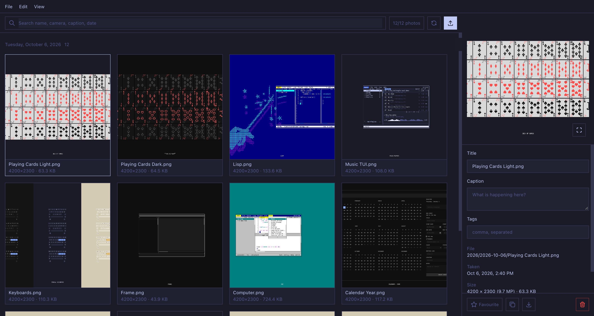

# photos

A photo library over a folder on disk. The grid is cut into days, months or
folders; each photo carries what its file already knew — when it was taken,
what took it, at what aperture — and what you add on top: a title, a caption,
tags, a favourite. Search reads all of it at once. Nothing is written back
into your images.



## Requirements

- [Bun](https://bun.sh)

## Run it

```sh
bun install
bun dev          # http://localhost:3000
```

Point it at a folder with `PHOTOS_DIR` (default `./photos`); anything else it
needs — the metadata cache, your captions, the trash — goes under
`PHOTOS_DATA_DIR` (default `./data`). `PORT` changes the port.

## Keys

`/` jumps to search, `←` and `→` walk the grid, Enter opens the photo full
size, `F` favourites it, `⌫` moves it to the trash. Ctrl/⌘-U uploads,
Ctrl/⌘-A selects everything showing, Ctrl/⌘-R rescans the folder, Escape
clears the selection. Shift-click a checkbox to take a run of photos. In the
lightbox the arrows move and Escape closes. The URL carries `?group=`,
`?sort=`, `?q=`, `?fav=` and `?photo=`, so a view can be bookmarked.

## What it reads

A file is read once and remembered by its size and modification time, so the
second start is instant. From the header come the pixel dimensions — JPEG,
PNG, GIF and WebP are each unpacked directly; from EXIF, read with `exifr`,
come the date taken, camera, lens, ISO, aperture, shutter, focal length and
GPS. A phone writes its sensor's shape and a rotation flag, so the size shown
is the one a browser will actually draw. A photo with no EXIF at all — a
screenshot, an export — keeps its file date and is filed under that.

Thumbnails are the small JPEG a camera already embedded, pulled out once into
`data/thumbs/`. There is no resizing step and nothing to install for one: a
file without an embedded preview is served whole.

## API

| Route                           | What                                                                       |
| ------------------------------- | -------------------------------------------------------------------------- |
| `GET /api/library`              | Every photo, the albums, and what is sitting in the trash                  |
| `POST /api/rescan?force=1`      | Walk the folder again; `force` re-reads every file rather than the changed |
| `GET /api/file?path=`           | The photo itself, with range requests                                      |
| `GET /api/thumb?path=`          | The embedded preview, or the file when there is none                       |
| `POST /api/upload`              | Multipart `files`, filed under `YYYY/YYYY-MM-DD/` by the date taken        |
| `PATCH /api/photo`              | `path` plus `title`, `caption`, `tags`, or `reset`                         |
| `DELETE /api/photo?path=&path=` | Move photos to the trash in one batch; returns a `batchId`                 |
| `POST /api/trash`               | `batchId` — put that batch back where it came from                         |
| `DELETE /api/trash`             | Empty the trash for good                                                   |
| `POST /api/favorite`            | `path`, `favorite`                                                         |
| `POST /api/albums`              | `name`, `paths`                                                            |
| `PATCH /api/albums/:id`         | `name`, `paths`, or `add` / `remove`                                       |
| `DELETE /api/albums/:id`        | Remove the album, not the photos                                           |

A path is always relative to the photos folder, with forward slashes and no
dot segments; anything else is refused rather than normalised. Errors come
back as `{ error }`.

## Where things go

A delete is a move into `data/trash/<batch>/` that keeps the photo's place in
the folder tree, along with the favourite and caption it had, so undo is the
same move backwards. Emptying the trash is the only thing that takes a file
off the disk.

| Path                    | What                                                     |
| ----------------------- | -------------------------------------------------------- |
| `src/app/`              | The page, the lightbox, and its API client               |
| `src/app/library.js`    | Searching, sorting and grouping — no fetching            |
| `src/server/library.js` | The folder: the scan, the EXIF cache, uploads, the trash |
| `server.js`             | `Bun.serve`: the page plus `/api`                        |
| `src/ui/`               | shadcn primitives (generated), the icons in use (tabler) |
| `src/shell/`            | App frame: layout, menubar, `useAppMenu`, dialogs        |

## CLI and MCP

Every API route is reachable without the browser, as a shell command and as an
agent tool.

### CLI

Every API route is available from `bun run cli`. Start an API-only server with
`HOST=127.0.0.1 bun run headless`, or connect the CLI to the existing web
server. Run `bun run cli --help` for commands; `PHOTOS_API_URL` or
`--base-url` selects the server. The executable is also declared as
`photos-cli` for `bun link`.

See [CLI.md](CLI.md) for examples, all commands, file and streaming I/O, exit
codes, and `bun run test:cli` verification.

### MCP

The app is an MCP server too. Every API route is a tool, over streamable HTTP
at `POST /mcp` on the running server, or over stdio with `bun run mcp`
(`--start` gives it an API-only server of its own). Connect an agent with
`claude mcp add --transport http photos http://localhost:3000/mcp`, or point
a stdio client at `mcp.js --start`. The executable is declared as `photos-mcp`.

See [MCP.md](MCP.md) for connecting, every tool, how files and results are
handled, and `bun run test:mcp` verification.

## License

MIT — see [LICENSE](LICENSE).
